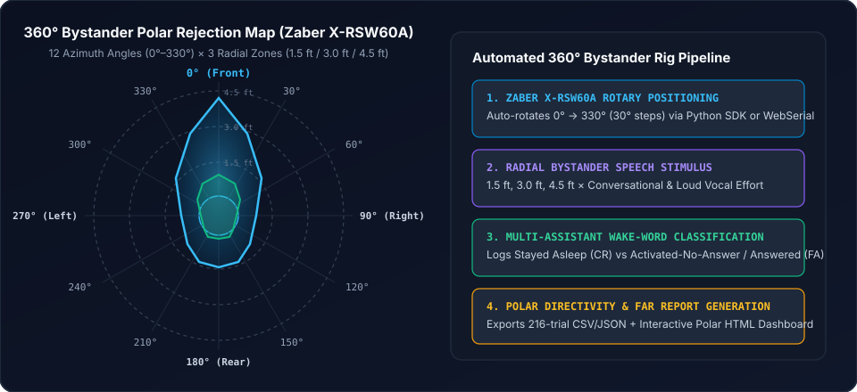

# XR Bystander Spatial Rig — 360° False-Wake & Polar Directivity Testbed

[](LICENSE)
[](https://www.python.org/)
[](backend/zaber_controller.py)
[](frontend/tester.js)

Automated **$360^\circ$ spatial bystander rejection and microphone polar directivity evaluation rig** for **XR Smart Glasses** and wearable voice assistants. Combines a motorized **Zaber X-RSW60A** rotary stage with a real-time web evaluation console and analytics studio to quantify **False Acceptance Rate (FAR)** across azimuth angles ($0^\circ$–$330^\circ$), radial distances ($1.5\text{ ft}$, $3.0\text{ ft}$, $4.5\text{ ft}$), and vocal effort levels (*Conversational* vs. *Loud*).



---

## Key Capabilities

1. **Automated $360^\circ$ Azimuth Positioning ($0^\circ$–$330^\circ$ in $30^\circ$ Steps):**
   - Synchronizes trial progression directly with a **Zaber X-RSW60A** motorized rotary stage so the eyewear under test rotates automatically to each target azimuth ($0^\circ, 30^\circ, 60^\circ, \dots, 330^\circ$) across $3$ radial bystander distances ($1.5\text{ ft}$, $3.0\text{ ft}$, $4.5\text{ ft}$).
2. **Dual-Stack Hardware Control (Python SDK + Chrome Web Serial API):**
   - **Backend Mode (`backend/zaber_controller.py`):** Thread-safe `zaber-motion` ASCII controller with automatic USB serial port discovery, stale port lock recovery, and auto-homing.
   - **Zero-Install Browser Mode (`frontend/tester.js`):** Built-in **Chrome Web Serial API (`navigator.serial`)** fallback enabling direct $115200\text{ baud}$ Zaber ASCII positioning directly from Google Chrome.
3. **Multi-Assistant Spatial Benchmarking:**
   - Supports comparative bystander false-wake testing across **Android XR (`Hey Google`, `OK Google`, `Hey Gemini` — 216 trials)** and **Meta AI (`Hey Meta`, `OK Meta` — 144 trials)** with within-angle randomized hotword/vocal-level ordering.
4. **Three-Tier Bystander Outcome Classification:**
   - Captures granular false-trigger severity:
     - `STAYED_ASLEEP` (*Correct Rejection — True Negative*)
     - `ACTIVATED_NO_ANSWER` (*Wake-Word Triggered, Subsequent Query Rejected*)
     - `ACTIVATED_ANSWERED_QUERY` (*Full Bystander False Acceptance*)
5. **Executive Polar Analytics Studio (`scripts/analytics_studio.py`):**
   - Aggregates multi-participant bystander sessions into polar directivity plots, distance $\times$ vocal-level heatmaps, and standalone HTML/CSV scorecards.

---

## Repository Structure

```text
xr-bystander-spatial-rig/
├── assets/
│   └── bystander_polar_directivity.svg         # 360° polar directivity & rig architecture diagram
├── backend/
│   ├── server.py                               # Unified HTTP + SSE telemetry & stage control server
│   ├── zaber_controller.py                     # Thread-safe Zaber X-RSW60A rotary stage driver
│   ├── telemetry_collector.py                  # ADB logcat & event stream collector
│   └── report_generator.py                     # Standalone executive HTML report generator
├── frontend/
│   ├── tester.html                             # 360° Bystander & Stage Control web console
│   ├── tester.js                               # Trial state machine, WebSerial driver & CSV exporter
│   └── styles.css                              # Responsive dark/light laboratory UI theme
├── configs/
│   └── gemini_bystander_suite.json             # 360° radial bystander test matrix configuration
├── scripts/
│   ├── bystander_automated_runner.py           # Headless CLI runner with Zaber stage synchronization
│   └── analytics_studio.py                     # Multi-session polar directivity & FAR analytics engine
└── start_testbed.sh                            # Turnkey launcher (auto-installs deps & opens console)
```

---

## Quick Start

### 1. Launch the Full Web Testbed & Zaber Stage Server
```bash
chmod +x start_testbed.sh
./start_testbed.sh
```
Open **`http://localhost:8080`** in Chrome:
1. Select **AI Assistant** (*Gemini Live - Android*, *Gemini Live - iOS*, or *Meta AI*).
2. Select **Conversation Mode:** `Bystander (360° Rotary Stage)`.
3. Verify the green **`✅ X-RSW60A connected`** status in the Stage Control Bar and click **Start Evaluation Session**.

### 2. Run the CLI Automated Bystander Runner
```bash
python3 scripts/bystander_automated_runner.py --participant P01 --distances "1.5 ft" "3 ft" "4.5 ft"
```

---

## Test Matrix Specification

| Factor | Levels | Count |
| :--- | :--- | :---: |
| **Radial Distance** | $1.5\text{ ft}$ ($0.45\text{ m}$), $3.0\text{ ft}$ ($0.90\text{ m}$), $4.5\text{ ft}$ ($1.37\text{ m}$) | $3$ |
| **Azimuth Angle** | $0^\circ, 30^\circ, 60^\circ, 90^\circ, 120^\circ, 150^\circ, 180^\circ, 210^\circ, 240^\circ, 270^\circ, 300^\circ, 330^\circ$ | $12$ |
| **Vocal Effort** | *Conversational* ($\sim 60\text{ dBA}$), *Loud* ($\sim 72\text{ dBA}$) | $2$ |
| **Target Wake-Words** | $3$ (*Android XR*) or $2$ (*Meta AI*) | $2\text{–}3$ |
| **Total Trials / Session** | **$216\text{ Trials}$** (*Android XR*) / **$144\text{ Trials}$** (*Meta AI*) | — |

---

## License
Released under the [MIT License](LICENSE).
